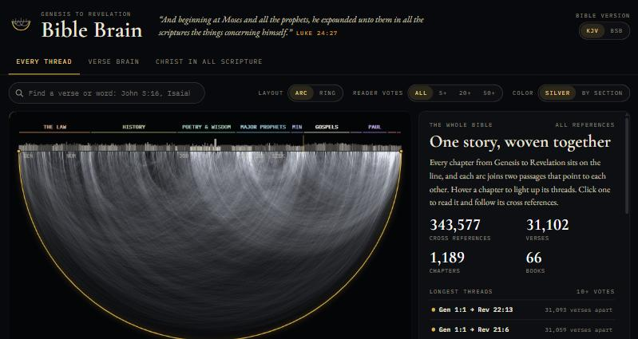

# Bible Brain

**Every cross reference in the Bible, Genesis to Revelation, as one interactive map.**

**Open it:** https://isaiahhuus.github.io/bible-brain/



> "And beginning at Moses and all the prophets, he expounded unto them in all the scriptures the things concerning himself." (Luke 24:27)

## What you can do

- **Every thread.** All 1,189 chapters sit on one line, and each of the 343,577 cross references is drawn as an arc between them. Hover a chapter to light up its threads, click it to read it, and click a verse to see every passage it points to. Switch to a ring layout, filter by reader votes, or color the threads by section of the Bible.
- **Verse brain.** Put any verse in the center and see its strongest connections around it, plus their connections. Click a verse to follow it and build a path through Scripture. The outer ring shows where each connected verse sits in the Bible, Genesis at the top running clockwise to Revelation.
- **Christ in all Scripture.** 30 threads that follow Jesus Christ from the first promise to its fulfillment, drawn in gold across the whole Bible: the Seed of the woman, the Lamb of God, the Suffering Servant, Psalm 22 at the cross, I AM, raised on the third day, the tree of life, and more.
- **Find anything.** Search a verse (`jn 3:16`), a chapter (`Isaiah 53`) or a word (`redeemer`).
- **KJV or BSB.** Switch every verse between the King James Version and the Berean Standard Bible. Each verse also links to the NIV on BibleGateway.
- **Share a verse.** Links open straight to a verse or a thread, for example `#isaiah-53-5` or `#christ-lamb`.

## Credits and licenses

| Data | Source | License |
|---|---|---|
| Cross references | [OpenBible.info](https://www.openbible.info/labs/cross-references/). They began with the public-domain Treasury of Scripture Knowledge and are ranked by reader votes. Changes made here: the 1,217 references readers voted below zero are left out, and the rest are repacked for this app. | [CC BY 4.0](https://creativecommons.org/licenses/by/4.0/) |
| King James Version (1769) | [farskipper/kjv](https://github.com/farskipper/kjv). Words in KJV italics are shown in italics. | Public domain ([The Unlicense](https://unlicense.org/)). In the United Kingdom, rights in the KJV are vested in the Crown. |
| Berean Standard Bible | The Holy Bible, Berean Standard Bible, BSB is produced in cooperation with Bible Hub, Discovery Bible, OpenBible.com, and the Berean Bible Translation Committee. This text of God's Word has been dedicated to the public domain. See [berean.bible](https://berean.bible/). Text file from [scrollmapper/bible_databases](https://github.com/scrollmapper/bible_databases). | Public domain (file: MIT License, Copyright (c) 2024 Scrollmapper) |

No NIV text is included. Every verse links to the NIV on [BibleGateway](https://www.biblegateway.com/versions/New-International-Version-NIV-Bible/). New International Version® and NIV® are registered trademarks of Biblica, Inc.

**Inspired by** [Visualizing the Bible](https://www.chrisharrison.net/index.php/Visualizations/BibleViz) by Chris Harrison and Christoph Römhild (2007), and a reel by [@thebibleinnumbers](https://www.instagram.com/thebibleinnumbers/).

**Built with** [d3](https://d3js.org/) (ISC License) and the fonts Cormorant Garamond, EB Garamond and IBM Plex Mono (SIL Open Font License), all loaded from public CDNs.

Full license texts and the list of changes are in [THIRD_PARTY_NOTICES.md](THIRD_PARTY_NOTICES.md).

## How it is built

- One static page (`docs/index.html`) plus three data files in `docs/data/`, served by GitHub Pages. No server, no tracking.
- The thread map is a density render: a Web Worker counts how many arcs cross each pixel, then tone-maps the result on a log scale, so 140,000+ overlapping threads stay readable instead of turning solid white.
- The verse brain uses [d3-force](https://d3js.org/d3-force) for layout.

### Rebuild the data

```bash
python pipeline/fetch.py raw
python pipeline/build.py raw docs/data
python tools/make_site.py
```

`pipeline/threads.py` holds the 30 curated threads; `build.py` checks that every reference in them exists.

### Preview locally

```bash
python tools/serve.py --site
```

Then open http://localhost:4891.

## Files

- `app/index.html`: the page source.
- `docs/`: the published site (generated by `tools/make_site.py` and `pipeline/build.py`). `docs/data/NOTICE.md` lists the license of each data file.
- `THIRD_PARTY_NOTICES.md`: credits, licenses and changes for every outside source.
- `pipeline/`: data download and build scripts.
- `tools/`: the local preview server and the site builder.

## Copyright

© 2026 Isaiah Huus. All rights reserved.

The app's code, design and curated threads may not be copied, changed or reused without permission. This notice does not cover the Bible text or the cross-reference data, which keep the licenses listed above. The adapted cross-reference data in `docs/data/xrefs.json` stays under CC BY 4.0.
